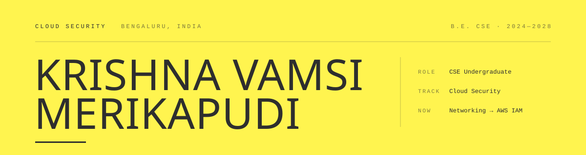

<picture>
  <source media="(prefers-color-scheme: dark)" srcset="assets/masthead-dark.svg">
  <source media="(prefers-color-scheme: light)" srcset="assets/masthead-light.svg">
  
</picture>

**Most breaches aren't clever.** They're a permission nobody scoped and a log nobody kept. Boring causes, expensive consequences — I'd rather work on the boring part.

---

### `01 / BRIEF`

I'm a Computer Science undergraduate in Bengaluru, a few semesters from a degree and considerably further from knowing everything. What I've figured out so far is that I like systems where a mistake costs something — which is a short description of both why I build and why I ended up pointed at cloud security.

So I build things that have **something worth protecting**, then go looking for the assumptions I got wrong. A restaurant POS handling real money taught me more about referential integrity and tamper-evident audit trails than any lecture did. A breach-lookup tool taught me you can answer *"was I exposed?"* without ever holding the user's secret.

Right now I'm working through networking fundamentals and AWS — identity, network boundaries, and the logging layer, in roughly that order. Certifications are on the calendar; the projects come first, because I'd rather be able to explain a design decision than recite a service list. Off the keyboard: cricket, video editing, and following a curiosity too far.

> `01`&nbsp;&nbsp;Least privilege is a design decision, not a cleanup task.
>
> `02`&nbsp;&nbsp;If it isn't logged, it didn't happen — and you can't prove it didn't.
>
> `03`&nbsp;&nbsp;Put the guarantee in the database, not in the hope that the app behaves.
>
> `04`&nbsp;&nbsp;Ship it. Then try to break it yourself, before someone less friendly does.

---

### `02 / CAPABILITY`

Rated by what I've actually built with, not what I've watched a tutorial on.

| Area | Stack | Level |
| :--- | :--- | :--- |
| **Backend & Databases** | MySQL · Schema design · Stored procedures · Triggers · Node.js · Express · REST | `●●●○` Working |
| **Frontend** | React · JavaScript · HTML · CSS · Tailwind · Recharts | `●●●○` Working |
| **Tooling & Delivery** | Git · GitHub · Vercel · Postman · Linux CLI · Figma | `●●●○` Working |
| **Security Practice** | Threat landscape · Breach intelligence · k-anonymity · Secrets handling · Audit logging | `●●○○` Practicing |
| **Cloud & Networking** | AWS core · IAM · S3 · EC2 · TCP/IP · DNS · VPC design | `●●○○` Learning |
| **Infrastructure as Code** | Docker · Terraform · CI/CD pipelines · Policy-as-code | `●○○○` Queued |

**Scale** — Queued · Learning · Practicing · Working · Fluent. Fluent is reserved for things I've shipped **and** maintained after they broke. Nothing has earned it yet.

---

### `03 / EVIDENCE`

Claims are cheap. Every entry below is live, open-source, or both.

<code>E—01</code>&nbsp;&nbsp;<b>Crunch &amp; Bubbles</b>&nbsp;&nbsp;·&nbsp;&nbsp;Restaurant POS &amp; analytics platform&nbsp;&nbsp;INTEGRITY

 

> **What it proves** — Real money moves through this. The guarantees live in the database (transactions, constraints, an append-only history) rather than in a hope that the application layer behaves.

A production-grade dine-in point of sale and management system, built from an empty schema. I treated it as a data-integrity problem first and a UI second: if the numbers can't be trusted, the dashboard on top of them is decoration.

| | |
| :--- | :--- |
| **Schema** | Normalized MySQL. Bills and Payments are decoupled, so one bill settles across cash + UPI natively and refunds are first-class rows rather than negative-number hacks. `ON DELETE RESTRICT` / `SET NULL` keeps financial history from ever being orphaned. |
| **Transactions** | Stored procedures wrap multi-step order placement and stock depletion in explicit `COMMIT` / `ROLLBACK` blocks with error handlers. A half-written order can't exist. |
| **Audit** | Triggers capture row state as JSON snapshots into an immutable `AuditLog`. Every change carries a before and an after — the difference between suspecting tampering and proving it. |
| **Automation** | Ingredient quantities decrement in real time as orders land. Scheduled MySQL Events run nightly maintenance and fire low-stock alerts without an external cron. |
| **Analytics** | Window functions (`RANK`, `LAG`) surface peak sales hours and per-staff performance directly in SQL. |
| **Interface** | React 19 dashboard — interactive floor-table mapping, a live kitchen tracking board, Recharts visualisations, and a print-ready thermal billing template. |

`MySQL` `Node.js` `Express` `React 19` `Recharts` &nbsp;·&nbsp; Apr 2026 – May 2026

**→ [Live staff portal](https://restaurant-app-delta-gold.vercel.app/admin)** &nbsp;·&nbsp; [Source](https://github.com/Krishnavamsi0018/restaurant-app) &nbsp;(sign-in required)

<code>E—02</code>&nbsp;&nbsp;<b>CipherSelf</b>&nbsp;&nbsp;·&nbsp;&nbsp;Personal privacy intelligence&nbsp;&nbsp;PRIVACY

 

> **What it proves** — You can tell someone they've been breached without ever receiving the thing that identifies them. k-anonymity, applied rather than cited.

A privacy exposure tool built for Vibexathon 1.0. It checks an address against known breach corpora, scores the result, and then does something more useful than a red banner: it shows you what the exposure is actually worth to someone buying it.

| | |
| :--- | :--- |
| **Lookup** | Breach detection through the XposedOrNot API using a k-anonymity range query — only a hash prefix leaves the client, so the full identifier is never transmitted or stored. |
| **Scoring** | A composite DNA Score (0–100) weighing breach count, recency, and the sensitivity of leaked field classes, so a leaked password and a leaked newsletter signup don't count the same. |
| **Framing** | Dark-web valuation in ₹ — abstract risk translated into a number people actually react to. |
| **Simulation** | A Groq-driven adversary walkthrough that narrates how an attacker would chain the specific exposures found, turning a report into a threat model. |

`React` `Vite` `Node.js` `XposedOrNot` `Groq`

**→ [Live site](https://cipherselfproject.vercel.app/)** &nbsp;(try `demo@cipherself.in`)

<code>E—03</code>&nbsp;&nbsp;<b>CodeBeta</b>&nbsp;&nbsp;·&nbsp;&nbsp;AI-assisted coding curriculum&nbsp;&nbsp;SECRETS

 

> **What it proves** — The credential stays on the server. The obvious version of this app ships a paid API key to every visitor's browser; this one doesn't.

A gamified learning platform with XP progression, graded code challenges, a multi-language curriculum, and an AI tutor that answers questions in context. The interesting engineering isn't the lessons — it's the boundary between the browser and the model.

| | |
| :--- | :--- |
| **Boundary** | All model calls route through a Node.js proxy. The client posts a question to my endpoint; the key, the provider, and the prompt scaffolding never leave the server. |
| **Tutor** | Groq-hosted inference for low-latency answers, scoped to the lesson the learner is currently on rather than answering anything asked of it. |
| **Progression** | XP-based advancement across challenges and languages, with state that survives a refresh. |

`JavaScript` `Node.js` `Groq API` `Vercel`

**→ [Live site](https://code-beta-phi.vercel.app/)** &nbsp;·&nbsp; [Source](https://github.com/Krishnavamsi0018/code-beta)

<code>E—04</code>&nbsp;&nbsp;<b>Portfolio</b>&nbsp;&nbsp;·&nbsp;&nbsp;Hand-built, no framework&nbsp;&nbsp;CRAFT

 

> **What it proves** — Restraint. One HTML file, no framework, no build step — and it prints correctly.

Designed and written from scratch as a document rather than a landing page: a typographic grid, hairline rules, tabular figures, and exactly as much motion as the content needed. The term counter reads from my actual enrolment dates, so it can't quietly go stale.

| | |
| :--- | :--- |
| **Constraints** | Zero dependencies beyond two typefaces. No tracking, no analytics, no cookie banner to decline. |
| **Access** | Semantic landmarks, keyboard-operable disclosures, visible focus rings, full `prefers-reduced-motion` support. |
| **Detail** | Paper and ink themes that persist, and a print stylesheet that renders the whole thing as a clean dossier. |

`HTML` `CSS` `Vanilla JS`

**→ [Live site](https://portfolio-mkv.vercel.app/)** &nbsp;·&nbsp; [Source](https://github.com/Krishnavamsi0018/PortfolioMKV)

---

### `04 / TRAJECTORY`

Graduating February 2028. This is the plan for the gap, written down so it's harder to drift from.

| Phase | Status | Focus |
| :--- | :--- | :--- |
| **01 · Build the base** 2024 – 2025 | `Complete` | Core languages, Git, a deployment pipeline that isn't manual. Relational modelling — keys, constraints, normalization. First projects shipped and publicly live. |
| **02 · Turn toward the cloud** 2026 – 2027 | `In progress` | Networking fundamentals (TCP/IP, DNS, routing, TLS). AWS core, then IAM and VPC design properly. Linux administration. Cloud Practitioner → Security+. Threat-model my own projects and write up the findings. |
| **03 · Do it for real** 2027 – 2028 | `Next` | A cloud security or DevSecOps internship. Infrastructure as code — Terraform, policy-as-code, CI security gates. Container and Kubernetes security. AWS Security Specialty. Contribute to an open-source security tool. |

<b>Credentials</b>

 

| | |
| :--- | :--- |
| Cybersecurity Job Simulation | Deloitte |
| Cybersecurity Job Simulation | Forage |
| FDF — Introduction to the Threat Landscape 3.0 | Certification |
| Python for Data Science | Certification |
| Member | IEEE |
| B.E. Computer Science & Engineering | Brindavan College · 2024–2028 |

---

### `05 / CONTACT`

Open to internships, security research, collaboration on something with real stakes, or a straight conversation about where to go deeper next. I read everything.

**Colophon** — Masthead set in Georgia and a system monospace, drawn by hand as SVG. Languages: English, Telugu, Hindi, Kannada, Tamil. Bengaluru, India.
